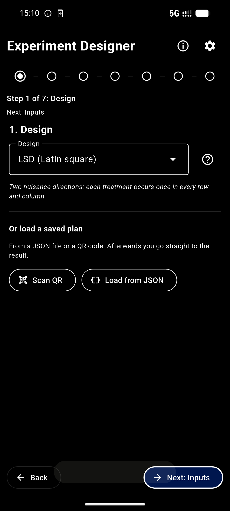
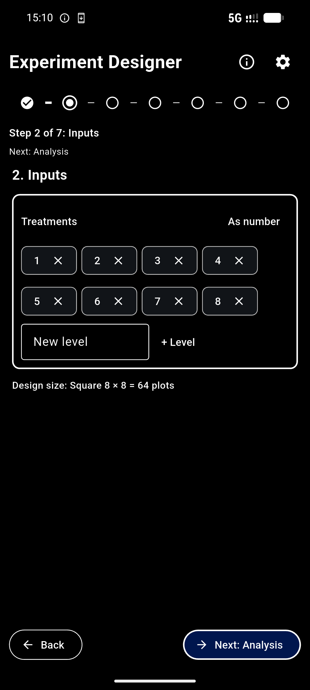
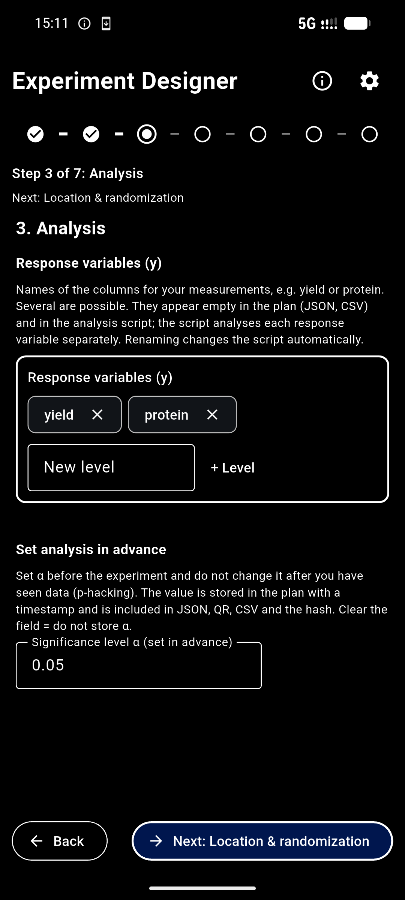
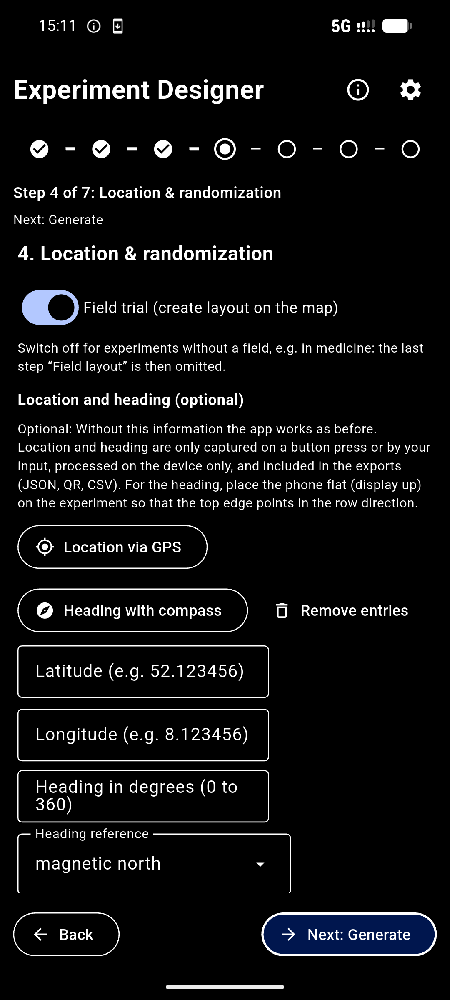
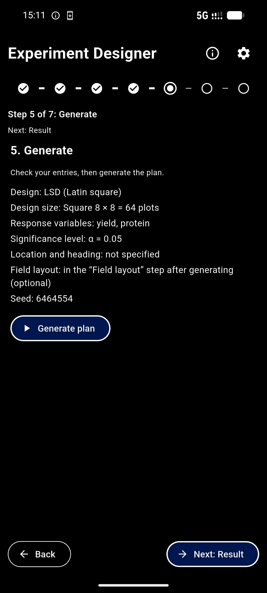
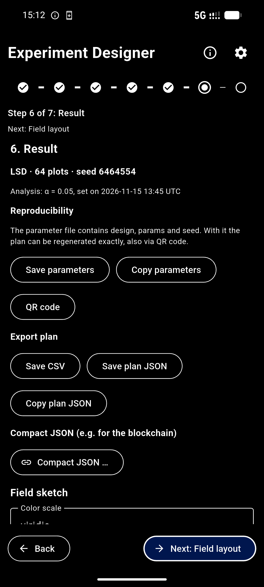
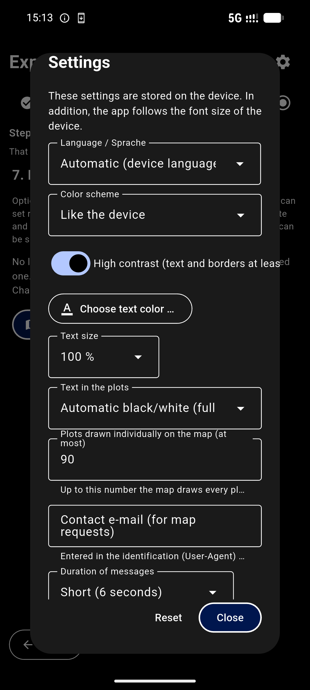

# Experiment Designer

**Offline-capable mobile app** (Python + [Flet](https://flet.dev)) that creates randomised experimental designs, lays them out on the field and archives them reproducibly.

It is a modern remake of the design functions of the R packages [agricolae](https://CRAN.R-project.org/package=agricolae) and [FielDHub](https://CRAN.R-project.org/package=FielDHub) that runs on an Android phone – completely offline.

> **New here?** Read the [vignette](docs/vignette.md): one worked example from design to a georeferenced, reproducible layout.


---

## Screenshots

| Step | Preview |
|------|---------|
| **Design** – Define design |  |
| **Inputs** – Define treatments |  |
| **Analysis** – Response variables & pre-specified α |  |
| **Location & Randomization** |  |
| **Generate** – Summary before creating the plan |  |
| **Result** – Exports, QR code, field sketch |  |
| **Field sketch** – Colour-coded overview |  |
| **Plan table** |  |
| **Settings** |  |
| **Field layout on map** |  |

---

## Features

- **21 design types**, generated on the device with a fixed seed
- **Field sketch** of the plan, coloured by treatment (colour-blind-friendly viridis family), exportable as SVG, PNG or JPEG
- **Custom symbols** for experiments without a field (e.g. medicine): emoji or uploaded icons
- **Field layout on a map** (optional): place plots on a row-column grid with plot size, gaps, paths and protective strips, anchored to GPS + compass heading on bundled OpenStreetMap tiles
- **Full reproducibility**: parameter file or QR code regenerates the identical plan. Canonical compact JSON with SHA-256 hash for time-stamped archiving
- **Pre-specified α**: fix the significance level with timestamp before data collection (guard against p-hacking)
- **Exports**: plan as JSON/CSV, parameters as JSON/QR, compact JSON with hash, field sketch, GeoJSON/KML
- **Starter analysis scripts** (Python + R) – experimental
- **Accessibility** (WCAG 2.2 AA): high-contrast themes, text scaling, black-and-yellow glove mode, screen-reader labels
- **English & German** interface (English default, German when device language is German)

---

## Designs

| Group | Designs |
|-------|---------|
| **Basic** | Completely randomized (CRD), Randomized complete block (RCBD), Latin square (LSD), Graeco-Latin square, Youden square |
| **Factorial** | Factorial (A×B…), Split-plot, Split-split-plot, Strip-plot |
| **Incomplete block** | BIB, Alpha design, Lattice, Rectangular lattice, Cyclic design, Resolvable IBD, Row-column design |
| **Augmented / Early generation** | Augmented block, Diagonal arrangement, Optimized check arrangement, Partially replicated (p-rep), Sparse testing |

The algorithms are original Python implementations and are **not identical** to the R functions.

---

## Installation

Requires **Python 3.10+**.

```bash
pip install "flet>=0.85.1" flet-camera flet-geolocator flet-map "segno==1.6.6" pillow

# Run on desktop
flet run main.py

# Build Android APK
flet build apk
